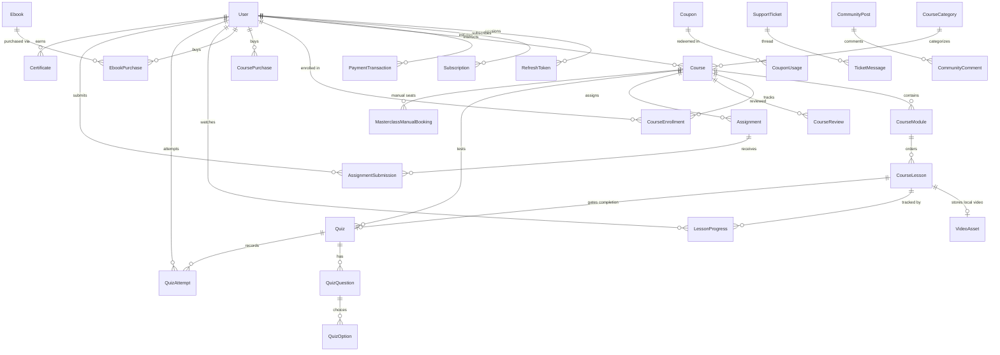
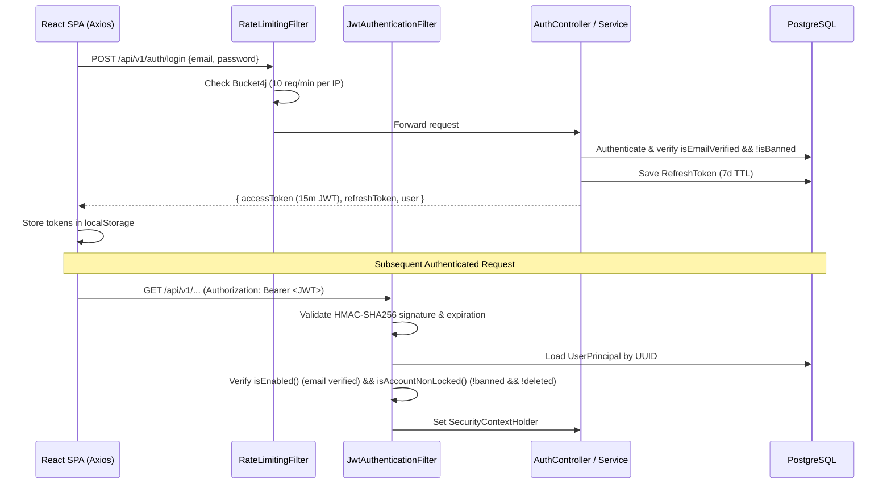
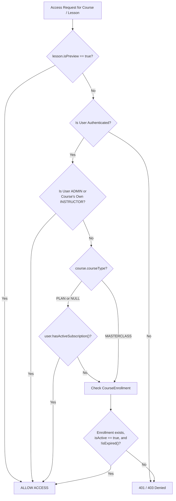

# SARALÖWE Academy — Complete Platform Technical Map & Architecture Audit

> **Status:** Read-Only Architectural Audit & Technical Mapping  
> **Scope:** Full-stack E-Learning Platform (`template/` React 19 SPA + `academy-backend/` Spring Boot 3.2.3 + PostgreSQL 16 + LibreTranslate + Nginx)

---

## 1. Overall System Architecture

SARALÖWE Academy is a luxury cake-design e-learning platform built as a containerized, multi-service architecture. In production (`docker-compose.yml`), all external traffic enters via **Nginx** on ports `80/443`, which serves the compiled React 19 Single-Page Application (SPA) and reverse-proxies REST API calls, protected/public file requests, and WebSocket connections to the internal Spring Boot backend.

```mermaid
graph TB
    subgraph Client["Browser / Client Tier"]
        SPA["React 19 SPA (TypeScript)<br/>Redux Toolkit + Axios + Video.js v8 + pdf.js"]
    end

    subgraph Edge["Reverse Proxy Tier (academy-frontend)"]
        Nginx["Nginx 1.27 Alpine (Ports 80 / 443)<br/>SSL Termination (Let's Encrypt SAN)<br/>SPA Static Serving"]
    end

    subgraph App["Application Tier (academy-backend :8080)"]
        Sec["SecurityFilterChain<br/>RateLimitingFilter (Bucket4j) + JwtAuthenticationFilter"]
        Ctrl["28 REST Controllers (/api/v1/*, /files/**)"]
        WS["STOMP over SockJS (/ws)<br/>WebSocketAuthInterceptor"]
        Svc["27 Domain Services + Schedulers + Caffeine Cache"]
        Signer["FileUrlSigner (HMAC-SHA256)<br/>VideoTokenService (In-Memory 2h TTL)"]
    end

    subgraph Data["Persistence & Storage Tier"]
        PG[("PostgreSQL 16 (academy-db)<br/>37 Flyway Migrations (V1–V37)")]
        VolUploads[("Volume: uploads_data (/app/uploads)<br/>Thumbnails, Avatars, Lesson Resources, Videos")]
        VolEbooks[("Volume: ebooks_data (/app/secure-storage/ebooks)<br/>Private Paid Ebook PDFs")]
    end

    subgraph External["Internal & Third-Party Integrations"]
        LT["LibreTranslate Container (:5000)<br/>Self-hosted AR ↔ EN Translation"]
        CMI["CMI Chaabi Payment Gateway<br/>3D Secure Form POST + S2S Callback"]
        PZ["PayZone Gateway (Legacy)"]
        Mux["Mux Video API (Legacy / Optional)"]
        SMTP["SMTP Server (Gmail)<br/>Thymeleaf Branded Emails"]
    end

    SPA -->|HTTPS| Nginx
    Nginx -->|/ → Static Bundle| SPA
    Nginx -->|/api/* , /files/*| Sec
    Nginx -->|/ws/* (Upgrade)| WS
    Sec --> Ctrl --> Svc
    WS --> Svc
    Svc --> Signer
    Svc --> PG
    Svc --> VolUploads
    Svc --> VolEbooks
    Svc --> LT
    Svc --> CMI
    Svc --> PZ
    Svc --> Mux
    Svc --> SMTP
```

### Deployment & Runtime Topology
- **`frontend` (`academy-frontend`)**: Multi-stage Docker build (Node 20 Alpine builds CRA bundle → Nginx 1.27 Alpine serves `/usr/share/nginx/html`). Handles multi-domain routing (`www.saralowe.ma`, `saralowe.com`, `www.saralowe.com`), converts CMI browser `POST /payment/callback` into `302 GET /payment/callback`, and proxies `/api/`, `/files/`, and `/ws/` to `http://backend:8080`.
- **`backend` (`academy-backend`)**: Eclipse Temurin 17 JRE Alpine running as non-root user `academy`. Not exposed on host ports (`expose: ["8080"]`); reachable only via the Docker bridge network `academy-net`.
- **`db` (`academy-db`)**: PostgreSQL 16 Alpine with persistent volume `postgres_data`. Schema is strictly governed by Flyway (`V1` through `V37`) with Hibernate `ddl-auto: validate` and `open-in-view: false`.
- **`libretranslate` (`academy-translate`)**: Self-hosted Argos Translate engine (`en,ar` models) exposed internally on port `5000` for non-blocking automatic content localization.

---

## 2. Main Modules & Their Responsibilities

### 2.1 Frontend Architecture (`template/src/`)
- **Routing & Layouts (`feature-module/router/`, `feature.tsx`, `authFeature.tsx`)**:
  - Uses `react-router-dom` v7 with lazy-loaded route chunks defined in `router.link.tsx` and path constants in `all_routes.tsx`.
  - `Feature` splits rendering into two modes based on `DASHBOARD_PREFIXES` (`/student/`, `/instructor/`, `/admin/`, `/course/add-course`, `/course/course-watch`):
    1. **Full-Screen / Dashboard Mode**: Renders `<Outlet />` directly without public header/footer. Dashboard pages wrap themselves in `LuxuryDashboardLayout` (`LuxurySidebar` + `LuxuryTopbar`). `CourseWatch` owns the full viewport (`100vh`).
    2. **Public Mode**: Wraps `<Outlet />` in public `Header`, `Footer`, `BackToTop`, and `PromoBar`.
- **Route Guards (`feature-module/common/`)**:
  - `RoleGuard`: Verifies `isAuthenticated` and checks `user.role` against `allowedRoles` (`STUDENT`, `INSTRUCTOR`, `ADMIN`). Redirects unauthorized roles to their respective dashboards.
  - `SubscriptionGuard`: Protects student routes and `/course/course-watch/:courseSlug` (requires authentication; optional `requireSubscription` flag redirects non-subscribers to `/pricing-plan`).
  - `SubscriptionGate`: Visual lock overlay with blurred ghost cards shown on catalog pages when a guest or non-subscriber views gated listings.
- **State Management (`core/redux/`)**:
  - Redux Toolkit store (`store.tsx`) with 8 slices: `authSlice`, `courseSlice`, `studentSlice`, `instructorSlice`, `adminSlice`, `cartSlice`, `sidebarSlice`, and `themeSettingSlice`.
- **API Client Layer (`services/api/`)**:
  - `axios.config.ts` provides two Axios instances (`api` for JSON and `apiMultipart` for `multipart/form-data`), both sharing a mutex-locked 401 token-refresh queue (`subscribeTokenRefresh`), automatic `Accept-Language` header injection, and automatic unwrapping of the backend's `ApiResponse<T>` envelope (`{ success, message, data }`).
  - 18 domain service modules (`auth`, `course`, `instructor`, `admin`, `subscription`, `payment`, `ebook`, `quiz`, `assignment`, `certificate`, `community`, `message`, `notification`, `profile`, `review`, `ticket`, `translation`).
- **Internationalization (`i18n/`, `hooks/`)**:
  - Static UI strings in English and Arabic (`en.json`, `ar.json`) with RTL support (`dir="rtl"`).
  - Dynamic database entities (courses, categories, assignments) are localized on the fly via `useLocalizedCourse`, `useLocalizedCategory`, and `translation.service.ts`.

### 2.2 Backend Architecture (`academy-backend/src/main/java/com/academy/`)
- **Config (`config/`)**:
  - `SecurityConfig`: Stateless JWT filter chain, CORS policies (standard allowed origins + permissive wildcard on `/api/v1/payments/cmi/callback` and `/return/**` for CMI gateway POSTs), endpoint authorization matrix.
  - `CacheConfig`: Caffeine in-memory caches (`courses`, `course-detail`, `categories`, `platform-stats`, `instructors`) with 10-minute TTL, keyed by locale language.
  - `SchedulerConfig`: Daily cron jobs for expiring subscriptions (`00:00`), sending expiry reminders (`09:00`), cleanup of old notifications, hourly eviction of expired video tokens, and `PendingPaymentReminderJob`.
  - `DataMigrationConfig`: Idempotent startup data backfills (`course_type = 'PLAN'`).
- **Controllers (`controller/` — 28 Controllers)**:
  - Auth (`AuthController`), Catalog & Enrollments (`CourseController`, `CategoryController`, `LessonController`, `VideoStreamingController`), Ebooks (`EbookController`), Payments & Subscriptions (`CmiPaymentController`, `PaymentController`, `SubscriptionController`, `CouponController`), Learning & Assessment (`QuizController`, `StudentQuizController`, `StudentAttemptController`, `AssignmentController`, `StudentAssignmentController`, `CertificateController`, `StudentReviewController`), Engagement (`CommunityController`, `MessageController`, `NotificationController`, `StudentTicketController`, `PublicContactController`), Role Portals (`InstructorController`, `AdminController`, `AdminCouponController`, `AdminTicketController`, `AdminContactController`, `ProfileController`), File Serving (`FileController`).
- **Services (`service/` & `service/impl/`)**:
  - Encapsulate all business rules, ownership checks, transactional boundaries, HTML sanitization (`HtmlSanitizer` via Jsoup), file URL signing (`FileUrlSigner`), PDF generation (`CertificateServiceImpl` via iText 7), payment callbacks (`CmiPaymentService`, `PayZoneService`), and background translation (`TranslationService`).

---

## 3. Database Entities & Important Relationships

The PostgreSQL database is managed across **37 Flyway migrations (`V1` to `V37`)** and mapped to **39 JPA Entities** (most extending `BaseEntity` with `UUID id`, `createdAt`, `updatedAt`).



### Key Entities & Domain Nuances
1. **`User` (`users`)**:
   - Soft-deleted via `@SQLDelete(sql = "UPDATE users SET is_deleted = true WHERE id = ?")` (`V22`). No global `@SQLRestriction` is used so foreign keys on historical transactions/enrollments never throw `EntityNotFoundException`.
   - Holds denormalized subscription fields (`subscription_status`, `subscription_start_date`, `subscription_end_date`) synchronized with the `subscriptions` table. `user.hasActiveSubscription()` checks `subscriptionStatus == ACTIVE && subscriptionEndDate > now()`.
   - Tracks `must_change_password` (`V7`) for bootstrapped admin accounts (`AdminBootstrapService`).
2. **`Course` (`courses`)**:
   - Differentiated by `course_type` (`V14`):
     - `PLAN`: Included in the subscription plan. Subscribers can access and enroll without additional payment.
     - `MASTERCLASS`: Requires individual one-time purchase (`requires_purchase = true`), even for active subscribers.
   - Differentiated by `masterclass_format` (`V26`, `V30`, `V33`):
     - `RECORDED`: Standard online curriculum with modules and video/text/quiz lessons.
     - `LIVE`: Bespoke live session with `session_date`, `session_start_time`, `session_end_time`, `session_location`, and `max_students` seat cap. Seats are consumed by completed CMI purchases (`CourseEnrollment`) plus WhatsApp manual bookings (`MasterclassManualBooking`).
   - Holds multilingual columns (`title_en`, `title_ar`, `title_fr`, `description_en`, `description_ar`, `description_fr`).
3. **`CourseModule` (`course_modules`) & `CourseLesson` (`course_lessons`)**:
   - Lessons have `content_type` (`VIDEO`, `TEXT`, `QUIZ`), `order_index`, `is_preview`, `text_content` (sanitized HTML), and `resources_json` (JSON array of attached files).
   - Video fields on `CourseLesson`: `video_file_path` (self-hosted relative path under `uploads/videos/`), `video_status` (`pending`, `uploading`, `processing`, `ready`, `error`), `video_duration_seconds`, and legacy Mux columns (`mux_asset_id`, `mux_playback_id`, `mux_upload_id`).
4. **`VideoAsset` (`video_assets`, `V13`)**:
   - Stores metadata for self-hosted videos (`lesson_id`, `file_path`, `original_filename`, `content_type`, `file_size`, `duration_seconds`, `video_status`).
5. **`CourseEnrollment` (`course_enrollments`) & `LessonProgress` (`lesson_progress`)**:
   - `CourseEnrollment` links `(user_id, course_id)` uniquely with `enrollment_type` (`SUBSCRIPTION`, `PURCHASE`, `FREE`), `is_active`, and `expires_at` (set to `subscriptionEndDate` for `SUBSCRIPTION` enrollments, `null` for `PURCHASE`). `enrollment.isAccessible()` checks `isActive && (expiresAt == null || expiresAt > now())`.
   - `LessonProgress` tracks per-lesson watch time (`watched_duration_seconds`, `last_position_seconds`, `is_completed`). Live course completion percentage is dynamically calculated from `LessonProgress` counts in `EnrollmentServiceImpl`.
6. **`Quiz` (`quizzes`), `Assignment` (`assignments`), `Certificate` (`certificates`)**:
   - A `QUIZ` lesson can be linked to a `Quiz` via `lesson_id` (`V10`). Passing the quiz automatically marks the linked lesson complete; `LessonServiceImpl.requireNotQuizGated()` blocks manual completion of quiz-gated lessons.
   - Certificates (`V32` unique per `(user_id, course_id)`) are auto-generated when all lessons in a course are completed **and** all published assignments for that course have been graded (`AssignmentServiceImpl.issueCertificateAfterCommit`).
7. **`Ebook` (`ebooks`) & `EbookPurchase` (`ebook_purchases`, `V27`, `V28`, `V34`)**:
   - Standalone digital books (`cupcake-evolution-vol-1`, `alchemy-in-layers-vol-1`) with language-specific PDF filenames (`pdf_en`, `pdf_fr`, `pdf_ar`) stored in `/app/secure-storage/ebooks` (outside `/uploads`).
8. **`AppSetting` (`app_settings`, `V21`, `V37`) & `ContentTranslation` (`content_translations`, `V23`)**:
   - `app_settings` stores live admin-configurable pricing (`subscription.monthly_price`, `subscription.yearly_price`), time-windowed promotional offers (`promo.id`, `promo.yearly_price`, `promo.starts_at`, `promo.ends_at`), and `masterclass.whatsapp_number`.
   - `content_translations` caches SHA-256 hashes of source strings and their LibreTranslate outputs.

---

## 4. Authentication & Authorization Flow



1. **Registration & Email Verification**:
   - `POST /api/v1/auth/register` creates a `STUDENT` account with `isEmailVerified = false` and sends a 24-hour verification link via `EmailService`. No JWT is issued until `POST /api/v1/auth/verify-email` succeeds.
2. **Stateless JWT & Refresh Token Rotation**:
   - Access tokens are signed with `HMAC-SHA` (`app.jwt.secret`) and expire in **15 minutes** (`900,000 ms`).
   - Refresh tokens are opaque UUIDs stored in `refresh_tokens` with a **7-day** TTL.
   - When an API call returns `401 Unauthorized`, `axios.config.ts` pauses concurrent requests via an in-memory promise queue, calls `POST /api/v1/auth/refresh-token` (which revokes the old refresh token and issues a fresh pair), and replays the queued requests.
3. **Immediate Ban & Soft-Delete Enforcement**:
   - `JwtAuthenticationFilter` loads `UserDetails` from the database on every JWT-authenticated request and checks `userDetails.isEnabled() && userDetails.isAccountNonLocked()`. Banning or deleting a user revokes access immediately without waiting for the 15-minute access token to expire.
4. **Rate Limiting**:
   - `RateLimitingFilter` applies a Bucket4j token bucket (10 requests/minute per client IP, stored in a bounded 100k-entry Caffeine cache) on `/api/v1/auth/{login,register,forgot-password,reset-password,verify-email,resend-verification,refresh-token}`. It only trusts `X-Real-IP` / `X-Forwarded-For` when the socket peer is a loopback or private network address (e.g., the Nginx container).
5. **WebSocket Security**:
   - `WebSocketAuthInterceptor` intercepts STOMP `CONNECT` frames, requires a valid `Authorization: Bearer <jwt>` native header, rejects anonymous or banned users, and blocks clients from sending STOMP `SEND` frames directly to `/topic/**` or `/queue/**` (allowing only `/app/**`).

---

## 5. Subscription & Course-Access Entitlement Flow

### 5.1 Subscription Plans & Checkout
- **Plans**: Monthly (`SUB-MON-*`, default 390 MAD) and Annual (`SUB-YEA-*`, default 3,900 MAD, or dynamic promo price via `SettingsService.getEffectiveYearlyPrice()` when a promo window like Black Friday `V37` is active).
- **Coupons**: Validated via `CouponService`; applicable only to the Annual plan. Coupon usage is recorded only after payment confirmation.
- **Payment Gateways**:
  - **Primary — CMI Chaabi Payment (`CmiPaymentController` / `CmiPaymentService`)**:
    1. Frontend calls `POST /api/v1/payments/cmi/initiate/subscription` (or `/course/{id}` or `/ebook/{id}`).
    2. Backend creates a `PENDING` `PaymentTransaction` with an order ID (`SUB-YEA-XXXXXXXX`, `CRS-XXXXXXXX`, or `EBK-XXXXXXXX`), signs all form parameters using CMI's SHA-512 store-key hash algorithm, and returns the form payload + `gatewayUrl`.
    3. Frontend auto-submits a hidden HTML `<form method="POST">` to CMI's 3D Secure gateway.
    4. CMI sends a server-to-server callback to `POST /api/v1/payments/cmi/callback`. Backend verifies the SHA-512 hash and `ProcReturnCode == "00"`, fulfills the order (`SubscriptionService.processSuccessfulPayment`, `CourseService` enrollment, or `EbookService.grantPurchase`), and returns plain text `"ACTION=POSTAUTH"`.
    5. CMI redirects the user's browser via `POST` to `/api/v1/payments/cmi/return/{success|failed}`, which issues an HTTP `302 Found` GET redirect to `${FRONTEND_URL}/payment/callback?txn=...&oid=...&result=...`. The React page polls `GET /api/v1/payments/cmi/status/{transactionId}` and refreshes the user profile.
  - **Secondary — Manual Admin Activation / Reprocessing**:
    - Admins can activate a yearly subscription directly via `POST /api/v1/admin/users/{id}/activate-subscription` or force-reprocess a stuck pending transaction via `POST /api/v1/admin/payments/{orderId}/reprocess`.

### 5.2 Course Access Decision Matrix (`EnrollmentServiceImpl.hasAccess`)
When a user requests a non-preview lesson (`GET /api/v1/lessons/{id}`), video URL (`GET /api/v1/lessons/{id}/video-url`), or lesson resources (`GET /api/v1/lessons/{id}/resources`), `enrollmentService.hasAccess(user, course)` evaluates entitlement in the following order:



- **On-the-Fly Enrollment Creation (`LessonServiceImpl.enrollmentFor`)**:
  - Because subscribers have immediate access to all `PLAN` courses via `hasActiveSubscription()` even before clicking "Enroll", `LessonServiceImpl.updateProgress()` and `markComplete()` automatically create a `CourseEnrollment` (`EnrollmentType.SUBSCRIPTION`) on the fly if one does not yet exist when progress is saved.

---

## 6. Video Upload, Storage, Streaming & Download Flow

The platform contains **two video architectures** (a primary self-hosted HTTP Range streaming system introduced in `V13`, and a legacy/fallback Mux integration), plus **two supplementary video surfaces** (lesson resource attachments and public course promo videos).

### 6.1 Video Upload Flow (Instructor / Admin)
1. **Primary Self-Hosted Upload (`CourseManage.tsx` → `instructorService.uploadVideo` / `VideoUploader.tsx`)**:
   - Sends `POST /api/v1/videos/{lessonId}/upload` (`multipart/form-data`, field `video`, max 4 GB).
   - `VideoStreamingController.uploadVideo` verifies ownership via `lessonService.verifyInstructorCanModifyLesson(lessonId, userId, role)`.
   - `VideoStorageServiceImpl.storeVideo` validates the extension (`mp4`, `webm`, `mov`, `m4v`, `ogv`, `ogg`, `mkv`) and streams the file to disk at `{uploadDir}/videos/{UUID}.{ext}` without holding a database connection open.
   - `LessonServiceImpl.registerLocalVideo` deletes any previous video file/record for that lesson, inserts a `VideoAsset` row, and sets `lesson.videoFilePath = "videos/{UUID}.{ext}"` and `lesson.videoStatus = "ready"`.
2. **Legacy Upload Endpoints (`InstructorController`)**:
   - `POST /api/v1/instructor/lessons/{id}/upload-video`: Creates a Mux direct upload URL.
   - `POST /api/v1/instructor/lessons/{id}/video`: Calls `MuxService.uploadVideoFile`. If Mux credentials are configured, uploads to Mux; otherwise falls back to saving locally under `{uploadDir}/videos/lessons/{lessonId}.mp4` and sets `muxPlaybackId = "local:videos/lessons/{lessonId}.mp4"`.

### 6.2 Video Playback & Streaming Flow (Subscriber / Student)

```mermaid
sequenceDiagram
    participant UI as CourseWatch.tsx / VideoPlayer.tsx
    participant LC as LessonController (/api/v1/lessons)
    participantVT as VideoTokenServiceImpl
    participant VC as VideoStreamingController (/api/v1/videos)
    participant FS as VideoStorageServiceImpl (Disk)

    UI->>LC: GET /api/v1/lessons/{lessonId}/video-url (Bearer JWT)
    LC->>LC: Verify lesson.isPreview OR enrollmentService.hasAccess(user, course)
    LC->>VT: generateToken(lessonId, userId)
    VT-->>LC: Opaque 32-char hex token (stored in ConcurrentHashMap, 2h TTL)
    LC-->>UI: VideoUrlResponse { playbackUrl: ".../api/v1/videos/{lessonId}/stream?token=..." }

    UI->>UI: Initialize Video.js v8 (<video-js>) with src = playbackUrl
    UI->>VC: GET /api/v1/videos/{lessonId}/stream?token=... (Range: bytes=0-)
    VC->>VT: validateToken(token, lessonId)
    VT-->>VC: true (valid & not expired)
    VC->>FS: streamVideo(filePath, rangeStart, rangeEnd)
    FS-->>VC: BoundedInputStream (RandomAccessFile seek, up to 10MB default chunk)
    VC-->>UI: 206 Partial Content (Content-Type: video/mp4, Accept-Ranges: bytes, Cache-Control: no-cache, no-store)
```

---

## 7. Important API Endpoints Summary

| Domain | Method & Path | Auth / Role | Purpose |
|---|---|---|---|
| **Auth** | `POST /api/v1/auth/{register,login,refresh-token,verify-email,forgot-password,reset-password}` | Public (Rate-limited 10/min) | User registration, JWT issuance, token rotation, password recovery |
| **Auth** | `GET /api/v1/auth/me`, `POST /api/v1/auth/logout-all` | Authenticated | Current user profile & session revocation |
| **Courses** | `GET /api/v1/courses`, `/slug/{slug}`, `/{id}`, `/{id}/curriculum` | Public (Drafts restricted to owner/admin) | Course catalog, details, and module/lesson outline |
| **Courses** | `POST /api/v1/courses/{id}/enroll`, `GET /api/v1/courses/my-courses`, `/{id}/my-progress` | Authenticated | Course enrollment and student progress lookup |
| **Lessons** | `GET /api/v1/lessons/{id}`, `GET /api/v1/lessons/{id}/video-url`, `GET /api/v1/lessons/{id}/resources` | Authenticated (Preview lessons allow access; non-preview requires `hasAccess`) | Full lesson content, signed video streaming URL, and signed resource URLs |
| **Lessons** | `POST /api/v1/lessons/{id}/progress`, `POST /api/v1/lessons/{id}/complete` | Authenticated (`hasAccess`) | Save watch position and mark lesson completed (unless quiz-gated) |
| **Videos** | `POST /api/v1/videos/{lessonId}/upload` | `INSTRUCTOR`, `ADMIN` | Upload self-hosted lesson video (up to 4 GB) |
| **Videos** | `GET /api/v1/videos/{lessonId}/stream?token=...` | Public (`permitAll`, gated by `VideoTokenService` token) | HTTP 206 Range streaming of lesson video |
| **Files** | `GET /files/**` | Public (`permitAll`, protected prefixes require `FileUrlSigner` HMAC `exp` & `sig`) | Serves uploaded thumbnails, avatars, and signed lesson resources |
| **Ebooks** | `GET /api/v1/ebooks`, `/{slug}` | Public | Ebook catalog and details |
| **Ebooks** | `GET /api/v1/ebooks/my-library`, `GET /api/v1/ebooks/{id}/content` | Authenticated (Ownership verified) | Buyer's ebook library and raw PDF binary stream for canvas reader |
| **Payments** | `POST /api/v1/payments/cmi/initiate/{subscription,course/{id},ebook/{id}}` | Authenticated | Generate signed CMI 3D Secure form parameters |
| **Payments** | `POST /api/v1/payments/cmi/callback`, `/return/**`, `GET /status/{txnId}` | Public (`permitAll`, CMI hash verified on callback) | CMI server-to-server webhook, browser POST-to-GET redirect, status polling |
| **Subscriptions** | `GET /api/v1/subscriptions/plans`, `/my-subscription`, `POST /cancel`, `/reactivate` | `/plans` Public; others Authenticated | View plans (with live promo pricing), manage user subscription |
| **Quizzes** | `GET /api/v1/student/quizzes/lesson/{lessonId}`, `POST /api/v1/student/attempts/start/{quizId}`, `/submit/{attemptId}` | Authenticated | Fetch student quiz, start timed attempt, submit answers (with anti-cheat violation flag) |
| **Assignments** | `GET /api/v1/student/assignments/course/{courseId}`, `POST /upload`, `POST /{id}/submit` | `STUDENT` | List course assignments, upload submission file, submit assignment |
| **Certificates** | `GET /api/v1/certificates`, `GET /{id}/download`, `GET /verify/{number}` | Authenticated (`/verify/**` Public) | List, download iText-stamped PDF certificate, public verification |
| **Instructor** | `/api/v1/instructor/**` | `INSTRUCTOR`, `ADMIN` | Course/module/lesson CRUD, resource upload, quiz/assignment grading, masterclass participants, earnings |
| **Admin** | `/api/v1/admin/**` | `ADMIN` | Platform stats, user management, course approval/rejection, manual subscription activation, payment reprocessing, pricing settings, coupons, tickets |

---

## 8. Critical Dependencies Between Modules

1. **Nginx Proxy Timeouts & Body Size vs. Video Upload Size**:
   - `application.yml` and `VideoStorageServiceImpl` allow **4 GB (`4096MB`)** video uploads, and `VideoUploader.tsx` / `instructor.service.ts` set `timeout: 0`.
   - **CRITICAL INFRASTRUCTURE MISMATCH**: In `template/nginx/nginx.conf` (lines 107–109), `location ^~ /api/` is configured with `client_max_body_size 100M;` and `proxy_read_timeout 120s;`. In production behind Nginx, any video upload larger than **100 MB** to `/api/v1/videos/{lessonId}/upload` will be rejected by Nginx with `413 Request Entity Too Large` before reaching Spring Boot.
2. **Enrolled Progress & Auto-Enrollment (`LessonServiceImpl` ↔ `EnrollmentServiceImpl`)**:
   - Subscribers can open any `PLAN` course in `CourseWatch` without an existing `CourseEnrollment` row because `hasAccess` checks `user.hasActiveSubscription()`. When the video player fires `updateProgress` (every 30s) or `markComplete`, `LessonServiceImpl.enrollmentFor()` auto-creates the `CourseEnrollment` row. Any modification to lesson streaming or progress must preserve this flow.
3. **Quiz Completion ↔ Lesson Completion ↔ Assignment Grading ↔ Certificate Issuance**:
   - `QUIZ` lessons cannot be completed via `POST /api/v1/lessons/{id}/complete` (`requireNotQuizGated`); they are marked complete inside `QuizServiceImpl.submitAttempt()` upon passing.
   - Course completion triggers `CertificateService.generateCertificate()`, which checks `assignmentRepository.countUngradedPublishedForStudent(course, user)`. If a course has published assignments, certificate generation is withheld until the instructor grades the submission in `AssignmentServiceImpl.gradeSubmission()`.
4. **FileUrlSigner ↔ HtmlSanitizer ↔ FileController**:
   - Instructor lesson HTML (`textContent`) can embed PDFs (`<div class="sl-pdf-embed" data-pdf-url="lesson-resources/...">`). On save, `LessonServiceImpl` strips any temporary `?exp=...&sig=...` query parameters (`fileUrlSigner.stripReferencesIn`) and sanitizes HTML (`HtmlSanitizer.clean`). On read (`LessonResponse.withContent`), `fileUrlSigner.signReferencesIn` re-signs all `lesson-resources/` paths with a 12-hour HMAC signature so `FileController` permits access.
5. **SecurityConfig Matcher Ordering**:
   - In `SecurityConfig.java`, specific authenticated `GET` matchers (`/api/v1/courses/my-courses`, `/api/v1/courses/wishlist`, `/api/v1/ebooks/my-library`, `/api/v1/ebooks/*/content`, `/api/v1/ebooks/*/download`) **must** remain declared before wildcard public matchers (`/api/v1/courses/**`, `/api/v1/ebooks/*`). Furthermore, `/api/v1/lessons/**` relies on `.anyRequest().authenticated()` at the bottom of the chain, meaning `GET /api/v1/lessons/{id}` and `GET /api/v1/lessons/{id}/video-url` require a valid JWT even for `isPreview = true` lessons.

---

## 9. Potential Security Vulnerabilities & Architectural Risks

### 9.1 Video & Content Protection Vulnerabilities (Focus of Phase 3 Audit)
1. **Unrestricted Full-File Video Download via Stream URL (`VideoStreamingController`)**:
   - `GET /api/v1/videos/{lessonId}/stream?token={token}` is `permitAll()` in `SecurityConfig` and relies solely on the 32-character token.
   - The token is **not bound to the user's session, IP, or headers**, and when a request is sent **without a `Range` header** (such as pasting the URL into a browser tab, clicking "Save Video As...", or running `curl`/`IDM`), `VideoStreamingController` sets `rangeStart = 0` and `rangeEnd = totalSize - 1` and returns the **entire MP4 file in a single `200 OK` response**.
2. **Native Browser Video Download Controls & Context Menu Enabled (`VideoPlayer.tsx` & `courseWatch.tsx`)**:
   - In `VideoPlayer.tsx`, Video.js creates a standard `<video>` element without `controlsList="nodownload"` and without blocking the right-click context menu (`onContextMenu`). Browsers (Chrome/Edge/Opera) can display native "Download" controls or allow right-click → **"Save video as..."**.
   - In `courseWatch.tsx` (line 1297), if an instructor attaches a `.mp4`/`.webm`/`.ogg`/`.mov` file as a lesson resource, it renders a raw `<video src={v.url} controls />` without `controlsList="nodownload"` or context-menu protection, pointing directly to `/files/lesson-resources/{file}?exp=...&sig=...` (valid for 12 hours, serving the full file via `FileController`).
3. **Legacy Mux Local Fallback Exposes Unsigned Path (`MuxService.java`)**:
   - In `MuxService.getSignedPlaybackUrl()` (lines 145–155), if `muxPlaybackId` starts with `"local:"`, it constructs `baseUrl + "/files/" + localPath` (e.g., `/files/videos/lessons/{id}.mp4`) **without signing it via `FileUrlSigner`**, which also breaks because `FileUrlSigner.PROTECTED_PREFIXES` blocks unsigned `/files/videos/**` requests with `403 Forbidden`.
4. **Google Docs External Viewer Leak for Office Attachments (`courseWatch.tsx` line 510)**:
   - Office attachments (`doc`, `docx`, `ppt`, `pptx`, `xls`, `xlsx`) are passed to `https://docs.google.com/gview?url=${encodeURIComponent(url)}&embedded=true`, transmitting a 12-hour signed URL to Google's external servers.

### 9.2 General Platform Security Observations
1. **Production Secrets in Environment Files on Disk**:
   - `.env.docker`, `.env.local`, and `academy-backend/.env` contain live credentials (database password, JWT secret, CMI store key, Gmail app password). While `.gitignore` excludes `.env`, `.env.local`, and `.env.docker`, these secrets should be rotated if they were ever shared or committed in git history.
2. **Dead Matcher in `SecurityConfig` for Ebook Download**:
   - `SecurityConfig.java` line 142 declares `.requestMatchers(HttpMethod.GET, "/api/v1/ebooks/*/download").authenticated()`, although `EbookController` removed the `/download` endpoint in favor of read-only `/content`.
3. **Single-Node In-Memory State (`VideoTokenServiceImpl`, `RateLimitingFilter`, `Caffeine`)**:
   - Video tokens and rate-limit buckets are stored in JVM memory. This is fine for the current single-container backend deployment, but would require Redis if horizontally scaled to multiple backend replicas.

---

## 10. Areas Where Changes Could Break Existing Functionality

1. **HTML5 `<video>` / Video.js Range Streaming Requirements**:
   - Browser `<video>` tags **cannot** send custom `Authorization: Bearer <jwt>` headers on standard media `src` requests, and they **must** be able to make multiple concurrent and sequential HTTP requests with `Range: bytes=start-end` headers over the duration of a viewing session (including seeking back and forth, or pausing and resuming).
   - Therefore:
     - Making `VideoTokenService` tokens **single-use** would immediately break video playback and seeking (a single video session makes dozens of Range requests).
     - Requiring a `Range` header unconditionally without testing browser initial probes must be done carefully: most modern browsers send `Range: bytes=0-` on initial `<video>` load, **or** if they omit `Range` or send `Range: bytes=0-`, returning a bounded chunk (or requiring `Range` + `Sec-Fetch-Dest: video` / `Referer`) must be tested across Chrome, Firefox, Edge, and iOS/macOS Safari.
2. **Safari / iOS Media Playback Compatibility**:
   - Notice `VideoPlayer.tsx` line 62: `overrideNative: !videojs.browser.IS_SAFARI`. Safari uses its native media engine for `<video>` playback and relies strictly on standard HTTP `206 Partial Content` and `Content-Range` responses, including suffix ranges (`bytes=-N`) and initial 2-byte probe requests (`Range: bytes=0-1`). `VideoStreamingController` already specifically supports suffix ranges (`parts[0].isBlank()`) for Safari compatibility — this logic **must not** be removed.
3. **Subscription Auto-Enrollment & Progress Tracking**:
   - `CourseWatch.tsx` passes `onTimeUpdate` and `onEnded` callbacks into `VideoPlayer.tsx`. Any change to `VideoPlayer.tsx` must preserve the exact props interface (`src`, `title`, `poster`, `autoPlay`, `startAt`, `onTimeUpdate`, `onEnded`, `className`, `style`) so 30-second progress heartbeats and auto-completion on video end continue to work identically.
